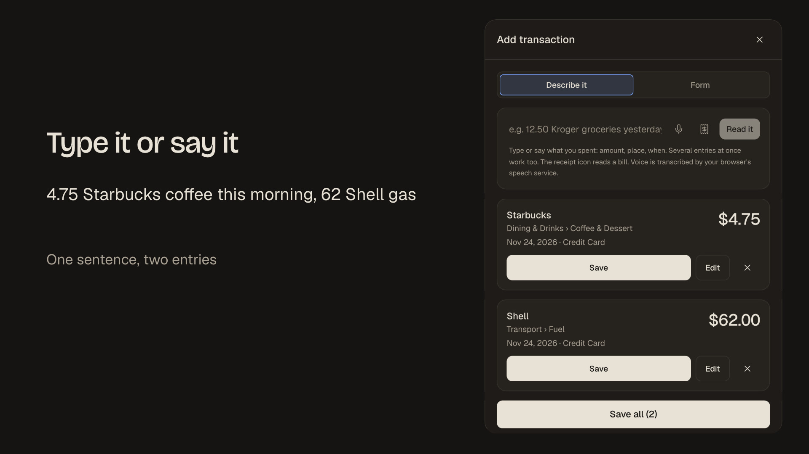

# Spend Analyser

A personal finance app that turns an expense spreadsheet into a fast, mobile-friendly dashboard.
Type, say or snap what you spent, ask questions about your own data, and see where the money went.
Budgets, spread purchases and EMIs, trips and credit cards are all built in.
Open source (MIT), self-hostable on **Vercel + Supabase**.

[](docs/assets/demo.mp4)

<sub>25-second demo (click to play). Recorded on a local demo account with made-up data. The AI results shown are real model output.</sub>

## Features

### Add spending the quick way (AI, optional)

- **Describe it**: type or say what you spent, e.g. "4.75 Starbucks coffee this morning, 62 Shell gas". Each entry comes back with merchant, category, date and payment method filled in, and you check it before saving. Several entries at once work too.
- **Voice**: transcribed by the AI provider when it has a speech model (Gemini, OpenAI). With Claude it uses the browser's speech recognition instead.
- **Receipts**: a photo, a PDF or a public Google Drive link is read into merchant, date, total, tax, card and every line item. You check it first, then link it to a transaction, create one, or keep it for later. A card number it hasn't seen before can be saved as a new card.
- **Items**: every line item from your receipts, searchable, with a shelf tag showing the latest unit price, the change from last time and a price sparkline.

### Ask your data (AI, optional)

- Ask about your own spending in plain words, e.g. "How much did I spend at Amazon this year?". The AI only has read-only tools (monthly totals, category and merchant totals, a transaction search). It never sees your whole history at once and can't change anything.
- **Written analysis**: a plain-language review of your totals, budgets and trends, with suggested actions. It sends totals only, and results are saved so reopening them is free.
- **Worth a second look**: an automatic check finds likely duplicates and unusually large expenses, and the AI explains each one in a sentence or clears it when it's expected.
- **AI tidy-up**: suggests categories for uncategorized rows, merges duplicate merchants and cleans card-statement names, and gives the same product one name across receipts. Nothing changes until you tick and apply.

### See where the money went

- **Overview**: four numbers (income, total spend, everyday spend, net savings), a transaction calendar coloured by spend type, a category donut against budgets, what's coming up, and "Am I saving?".
- **Insights**: where the month is heading (spent so far, already booked and a projected month end), spent vs earned over 12 months, a "Where did the money go?" flow from income through categories to merchants, category movers, budget gauges, charges that repeat every month, your spending days of the week, and quick automatic checks.
- **Transactions**: filter by month, category, subcategory, everyday only, trip, merchant, payment method, person or text. The totals, Jan–Dec chart, breakdowns and list all follow the filter. Add, edit, duplicate and delete in a few taps, with bulk delete and undo.
- **Big costs smoothed**: EMIs, spread purchases and lump-sum trips count evenly across their months, so one big purchase doesn't make a month look terrible.
- **Everyday spending**: mark categories as everyday (controllable) or fixed (rent, tuition), and filter the calendar and donut to everyday only.

### Plan ahead

- **Budgets per category per month**: each month carries forward the last budget you set. Changing a month applies from that month onward.
- **Plans (spread / EMI)**: count a big purchase over several months, either paid upfront or as installments. Future months show what's already committed.

### Trips

- Trip spending stays out of your monthly numbers by default. Each trip can instead count as one lump sum (optionally spread over months) or as each of its expenses.
- Per-trip budget, per-day spend, companions and a breakdown by type (flights, hotel, food…). Finished trips show as stamps under "Visited".

### Credit cards

- Mark a payment method as a credit card with its limit and billing days. Cards shows what you owe on each card, your latest bill, when it's due, and how much of your limit you're using, overall and month by month.
- Recording a bill payment lowers what's owed without counting as spending. EMI purchases block the full amount of the limit straight away.
- Notifications for bills due soon or overdue, statements ready and high utilization, alongside budget and month-review notices.

### Everything else

- **People and settle up**: record who paid for an expense and see the running balance with each person.
- **Multi-currency**: 120+ currencies. Each transaction keeps its original amount and the day's exchange rate. Change the default currency any time and everything is converted. INR uses lakh grouping (₹1,00,000).
- **Import / export**: imports the Expense Tracker workbook, or a bank or spreadsheet export (CSV/XLSX/XLS with a Date column and an Amount column, or Debit and Credit columns). It detects the encoding, delimiter, date order, decimal mark and sign convention, shows what it found with overrides, skips unreadable rows with a reason, and skips rows you already imported. Exports Excel/CSV in the same columns (re-importable) and a full JSON backup.
- **Light, dark or system theme**, and installable as an app on your phone.
- **Accounts**: sign up, email confirmation, sign in, forgot/reset password, change email/password, sign out everywhere, delete account. Passwords are hashed by Supabase Auth (bcrypt); the app never sees them.

## Stack

Next.js 16 (App Router, Server Actions) · TypeScript · Tailwind CSS 4 · Supabase (Postgres + RLS, Auth, Storage) · Vercel AI SDK (Gemini, Claude or OpenAI) · SheetJS · Vitest · Playwright · pgTAP

All money logic lives in Postgres so every client gets the same answers. That includes the `ledger()` function, installment schedules, carry-forward budgets, atomic imports and AI quotas. Every table uses row-level security plus composite foreign keys, so one user can never reference another user's rows.

## Run locally

Requirements: Node 22+, Docker (or Colima), npm.

```bash
npm install
npx supabase start          # local Postgres, Auth, Storage, Mailpit
cp .env.example .env.local  # paste the keys printed by `supabase start`
npm run dev                 # http://localhost:3000
```

Sign-up confirmation and password-reset emails land in Mailpit at http://127.0.0.1:54324.

Optional: turn on the AI features by setting `AI_PROVIDER` (`gemini`, `claude` or `openai`) and that provider's key in `.env.local`. Without a key the AI features stay hidden. `AI_PROVIDER=mock` returns fixed sample answers for development and tests, and is refused in production.

Optional: `scripts/seed-test-user.sh` creates a local-only demo user with about 450 made-up transactions (it refuses to run against a non-local Supabase).

## Deploy (Supabase + Vercel)

1. **Supabase**: create a project, then push the schema:
   ```bash
   npx supabase link --project-ref <ref>
   npx supabase db push
   ```
   In **Authentication → URL Configuration**, set *Site URL* to your Vercel URL and add `https://<your-domain>/**` to *Redirect URLs*.
   In **Authentication → Providers → Email**, keep *Confirm email* on. For real use, set up custom SMTP: the built-in mailer only sends a few emails per hour.
   Install the email templates from `supabase/templates/` (**Authentication → Emails**, or `npx supabase config push` with a `[remotes.<name>]` block for your project). They link to `/auth/confirm?token_hash=…`, so confirmation and password-reset links work on any device, not only in the browser that asked for them.
2. **AI** (optional): get an API key from Google AI Studio (a GCP project with billing), console.anthropic.com or platform.openai.com.
3. **Vercel**: import the repo and add the environment variables from `.env.example`:

   | Variable | Notes |
   |---|---|
   | `NEXT_PUBLIC_SUPABASE_URL`, `NEXT_PUBLIC_SUPABASE_PUBLISHABLE_KEY` | Project Settings → API |
   | `SUPABASE_SECRET_KEY` | **server only**; used for account deletion, AI quota and the FX cache |
   | `NEXT_PUBLIC_SITE_URL` | your deployment URL (used in email links) |
   | `AI_PROVIDER` | `gemini` (default), `claude` or `openai` |
   | `GEMINI_API_KEY` / `CLAUDE_API_KEY` / `OPENAI_API_KEY` | only the selected provider's key is needed |
   | `AI_MODEL_FAST`, `AI_MODEL_SMART` | optional model overrides (defaults per provider) |
   | `AI_LIMIT_ANALYSIS`, `AI_LIMIT_PARSE`, `AI_LIMIT_ORGANIZE`, `AI_LIMIT_CHAT`, `AI_GLOBAL_DAILY_LIMIT` | monthly per-user limits (analyses, entries and receipts, tidy-up runs, questions) and an instance-wide daily cap |

## How the numbers work

- **Spent** = expenses − refunds. Income is tracked separately. **Net saved** = income − spent.
- **Everyday spend** = spending in categories marked as everyday.
- **Future-dated rows** (scheduled payments, upcoming installments) don't count in "to date" figures until their date arrives. Future months show them as *committed*.
- **How big costs count** (smoothed, so averages and budgets stay fair):

  | Kind | Counts as |
  |---|---|
  | Spread (paid upfront) | one equal part per month ("Spread 3/12") |
  | EMI (paid in installments) | each installment in the month it's due ("EMI 2/12") |
  | Trip, *not counted* | ignored in monthly totals (still on the trip page) |
  | Trip, *each expense* | each expense in its own category |
  | Trip, *lump sum* | one entry in a category and month you pick, optionally spread over months |

- **Budget status**: *Over* above 100%, *Near limit* at 80% or more, otherwise *On track*.
- **Card utilization**: what you owe across credit cards ÷ their combined limit. Bill payments lower what's owed and never count as spending.

## Tests

```bash
npm test            # unit tests (analytics, budgets, installments, importer, receipts, cards, AI config)
npm run test:db     # pgTAP: ledger modes, trips, budgets, RLS isolation, quotas, import, currency rebase
npm run test:e2e    # Playwright on iPhone + desktop: auth, CRUD, import parity, every page, budgets, trips, export, currency, AI (mock)
```

If `Expense_Tracker.xlsx` is in the repo root, the import tests check that every month matches the spreadsheet to the cent. The workbook is git-ignored: keep personal data out of the repo.

## Privacy

- Nothing goes to the AI provider unless you press a button, and only the configured provider (Gemini, Claude or OpenAI) is used.
- Written analysis only sends totals (monthly category sums, budgets, top merchants), never individual transactions or notes.
- Ask your data gives the AI read-only tools over your own data and nothing else. It can't change anything.
- Describe-it entry sends the text you typed or said. Receipt reading sends the receipt file.
- Receipt files are stored in a private bucket, reachable only by their owner through short-lived signed links.
- Drive links are fetched only from Google hosts (redirects are re-checked), capped at 10 MB, and file types are verified by content.
- Each account has monthly AI allowances, and the server has a daily cap across all accounts.

## License

MIT
